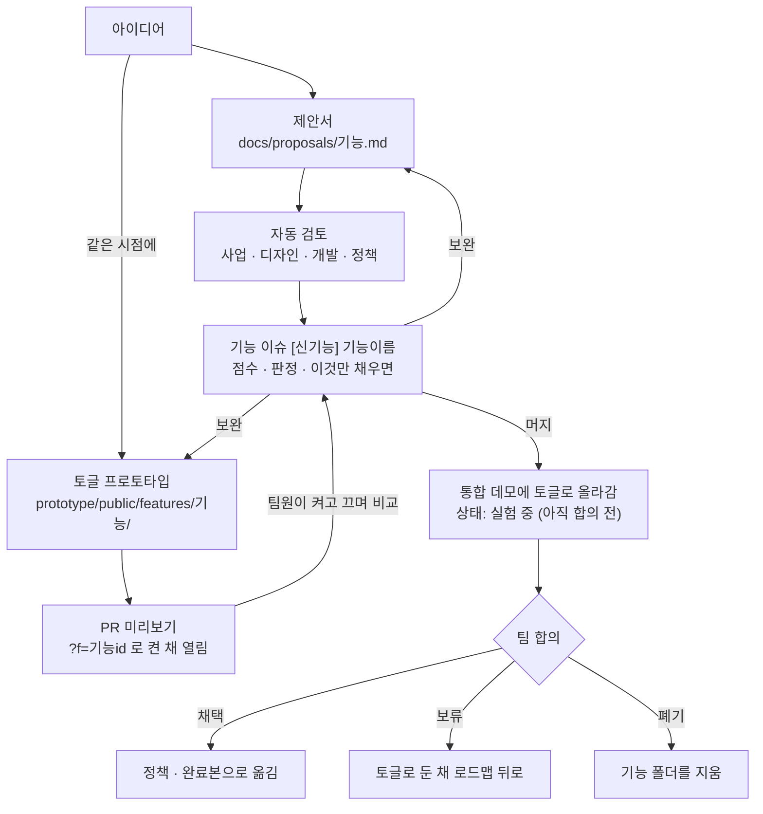

# DANGJANG

DANGJANG(당신의 옷장)은 새로 만드는 패션 커머스 서비스다. 다른 패션 커머스와의 차별점은 옷장이다. 잘 맞는 내 옷을 옷장에 등록하면, 사기 전에 상품의 부위별 핏을 그 옷과 비교해 알려 준다.

- 데모: https://dangjang-prototype.vercel.app
- KAI10 이커머스1팀 팀 프로젝트 · 최종 발표 2026-11-05

**문제.** 키·몸무게가 같은 사람의 후기를 봐도, 내 비율에서 밑위·기장·어깨가 어디에 떨어질지 사기 전에 알 수 없다. 설문 24명 중 핏 확인형 13명에서, 최근 6개월에 3벌 이상 실패한 사람이 6명이었다. 나머지 11명 중에서는 1명이었다.

**해결.** 이미 잘 맞는 내 옷(기준 옷)을 한 번 등록하면, 상품 상세에서 그 옷과 부위별로 cm 차이를 비교해 사이즈를 추천한다.

## 팀

<table>
  <tr>
    <td align="center"><a href="https://github.com/jincode93"> 진준호</a></td>
    <td align="center"><a href="https://github.com/juribb"> 최주리</a></td>
    <td align="center"><a href="https://github.com/Artemis-ignis"> 박준성</a></td>
    <td align="center"><a href="https://github.com/cre2mo"> 이다영</a></td>
    <td align="center"><a href="https://github.com/seoulkorea-dev"> 인정우</a></td>
  </tr>
</table>

## 이 레포를 만든 이유

1. 정책, 용어, 디자인 시스템, 프로토타입을 한 곳에 둔다. `main`이 팀이 합의한 최신 상태다.
2. 제안서와 프로토타입을 같은 시점에 만들어 합의를 기다리지 않고 실제로 만들어 본 뒤 판단한다.
3. Claude 스킬이 제안서를 사업성, UX, 개발 가능성, 정책 네 관점으로 점수 매기고 빈 곳을 짚는다. 사람은 결정에 집중한다.
4. 신기능은 완료본과 떼어 토글로 붙인다. 모두가 같은 화면에서 켜고 끄며 비교하고 링크 하나로 폰에서도 본다. 기각되면 폴더 하나만 지운다.
5. Claude Code에게 말로 부탁하면 PR까지 만든다. 결정과 이유는 기능 이슈, 결정 기록, 리뷰 점수로 쌓인다.

## 목표

- 최종 발표(11/5)까지 핵심 흐름(기준 옷 등록 → 상품 상세 부위별 비교 → 사이즈 추천)을 데모에서 끝까지 동작하게 한다.
- 신기능은 제안 → 검토 → 채택·보류·폐기를 빠르게 돈다. 채택된 것만 정책과 완료본으로 옮긴다.

## 신기능 제안 플로우

머지는 합의가 아니다. 통합 데모에 토글로 올라갈 뿐, 토글을 끄면 데모는 완료본과 똑같다.

## 자동 검토

**신기능 제안서.** 제안서 PR을 올리면 GitHub Actions가 Claude를 실행해 네 관점을 동시에, 서로의 결론을 보지 않고 검토한다. 결과는 기능 이슈에 쌓이고 PR에는 판정만 달린다. 판정은 조언이고 결정은 사람이 한다.

| 관점 | 스킬 | 묻는 것 |
|---|---|---|
| 사업 | `review-ceo` | 돈과 고객이 얼마나 움직이나 |
| 디자인 | `review-design` | 어디서 만나고 왜 쓰고 막히면 어떻게 되나 |
| 개발 | `review-eng` | 무엇이 있어야 만들고 어디서 깨지나 |
| 정책 | `review-policy` | 개발자와 QA가 물을 질문에 답하나 |

**데모·문서.** [gstack](https://github.com/garrytan/gstack)(MIT) 리뷰를 고친 CEO·디자인·엔지니어 리뷰로 차원별 0~10점을 매기고 점수 변화를 `reviews/scores.csv`에 쌓는다(`/review-ceo 통합 데모` 등). 출처는 `.claude/skills/NOTICE.md`.

## 사용법

이 레포는 **Claude Code로만** 작업한다. 처음 연결하는 법과 지킬 것은 [`CONTRIBUTING.md`](CONTRIBUTING.md). 연결한 뒤에는 이 레포 폴더에서 Claude Code를 열고 말로 부탁한다.

| 하고 싶은 것 | 이렇게 말한다 |
|---|---|
| 작업 시작 | "최신으로 맞춰 줘." |
| 신기능 제안 | "날씨 맞춤 추천 기능을 제안서로 만들고, 토글 프로토타입도 같이 만들어 줘." |
| 정책 고치기 | "REC-04 판정 기준을 부위별로 다르게 고치고 PR 올려 줘." |
| 화면 확인 | "프로토타입 미리보기 띄워 줘." / "40번 PR 미리보기 링크 줘." |
| 수정 요청 반영 | "PR에 달린 댓글 보고 고쳐 줘." |

## 어디에 무엇이 있나

| 보고 싶은 것 | 위치 |
|---|---|
| 무엇을 왜 만드나 (문제, 타깃, 지표) | `docs/prd.md` |
| 정책 · 용어 · 아직 정하지 않은 것 | `docs/policy/`, `docs/glossary.md`, `docs/open-questions.md` |
| 신기능 제안서와 양식 | `docs/proposals/` |
| 데모 코드와 신기능 토글 | `prototype/` (`public/features/`가 토글) |
| 디자인 시스템 | `design-system/` |
| 리서치 · 일정 · 멘토링 | `docs/research/`, `docs/timeline.md`, `docs/mentoring/` |
| 평가 기준 · 리뷰 결과 | `docs/eval/`, `reviews/` |
| 결정 이력 | `logs/decision-log.md` |
| AI 리뷰 스킬 · 자동 검토 | `.claude/skills/`, `.github/workflows/` |
