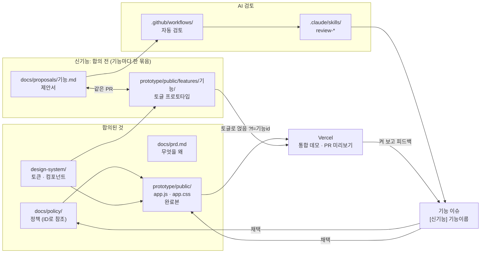
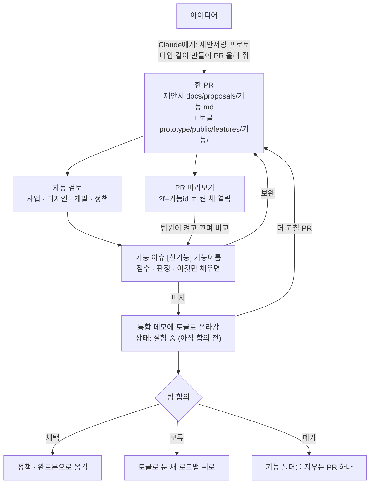

# DANGJANG

DANGJANG(당신의 옷장)은 새로 만드는 패션 커머스 서비스다. 다른 패션 커머스와의 차별점은 옷장이다. 잘 맞는 내 옷을 옷장에 등록하면, 사기 전에 상품의 부위별 핏을 그 옷과 비교해 알려 준다.

- 데모: https://dangjang-prototype.vercel.app
- KAI10 이커머스1팀 팀 프로젝트 · 최종 발표 2026-11-05

**문제.** 키·몸무게가 같은 사람의 후기를 봐도, 내 비율에서 밑위·기장·어깨가 어디에 떨어질지 사기 전에 알 수 없다. 설문 24명 중 핏 확인형 13명에서, 최근 6개월에 3벌 이상 실패한 사람이 6명이었다. 나머지 11명 중에서는 1명이었다.

**해결.** 이미 잘 맞는 내 옷(기준 옷)을 한 번 등록하면, 상품 상세에서 그 옷과 부위별로 cm 차이를 비교해 사이즈를 추천한다.

## 팀

<table>
  <tr>
    <td align="center"><a href="https://github.com/jincode93"><br>진준호</a></td>
    <td align="center"><a href="https://github.com/juribb"><br>최주리</a></td>
    <td align="center"><a href="https://github.com/Artemis-ignis"><br>박준성</a></td>
    <td align="center"><a href="https://github.com/cre2mo"><br>이다영</a></td>
    <td align="center"><a href="https://github.com/seoulkorea-dev"><br>인정우</a></td>
  </tr>
</table>

## 이 레포를 만든 이유

기획 문서와 프로토타입이 각자의 폴더와 아티팩트에 흩어져 있으면, 같은 기능을 두고 서로 다른 버전을 보며 이야기하게 된다. 이 레포는 그 문제를 풀려고 만들었다.

1. **같은 기준에서 일한다.** 정책, 용어, PRD, 디자인 시스템, 프로토타입을 한 곳에 둔다. 누구든 `main`을 받으면 팀이 합의한 최신 상태를 본다.
2. **신기능을 문서와 프로토타입으로 함께, 빠르게 만든다.** 아이디어가 생기면 제안서(페이퍼워크)와 그 기능의 프로토타입을 한 PR로 같이 올린다. 합의를 기다렸다가 만드는 게 아니라, 합의하기 전에 실제로 만들어 보고 판단한다. 정책과 완료본은 건드리지 않으니 부담 없이 올린다.
3. **AI가 같은 기준으로 먼저 검토한다.** 제안서를 올리면 Claude 스킬이 사업성, UX, 개발 가능성, 정책 충돌 네 관점으로 점수를 매기고 빈 곳을 짚는다. 사람은 그 결과를 보고 결정에 집중한다.
4. **같은 화면에서 켜 보고 피드백한다.** 신기능 프로토타입은 완료본과 떼어 토글로 붙인다. 팀원 모두가 같은 데모에서 그 기능을 켜고 끄며 지금 화면과 비교하고, 링크 하나로 폰에서도 본다. 합의되지 않은 기능이 완료본을 흔들지 않고, 기각되면 폴더 하나만 지우면 된다.
5. **git을 몰라도 참여한다.** Claude Code에게 말로 부탁하면 브랜치, 커밋, PR을 대신 만든다. 팀 규칙은 `CLAUDE.md`에 있어서 누가 부탁해도 같은 방식으로 일한다.
6. **결정과 근거가 남는다.** 왜 그렇게 정했는지가 결정 기록, 기능별 이슈, 리뷰 점수로 쌓인다. 발표나 멘토링에서 "왜?"라는 질문에 파일로 답한다.

## 목표

- **최종 발표(11/5)까지:** 핵심 흐름(옷장에 기준 옷 등록 → 상품 상세에서 부위별 비교 → 사이즈 추천)을 데모에서 끝까지 동작하게 한다. 리뷰에서 나온 출시 수준 문제(`reviews/2026-10-26-출시수준-점검목록.md`)를 줄인다.
- **신기능:** 제안서와 토글 프로토타입을 함께 만들고 → 자동 검토와 팀 피드백으로 다듬고 → 채택·보류·폐기를 빠르게 정한다. 채택된 기능만 정책과 완료본으로 옮긴다.
- **기록:** 정책은 개발자와 QA가 바로 쓸 수 있는 수준으로, 결정은 근거와 함께 남긴다.

## 레포 설계도



| 폴더 | 무엇이 있나 | 누가 고치나 |
|---|---|---|
| `docs/` | PRD, 정책, 용어집, 제안서, 리서치, 멘토링, 평가 기준 | 정책은 확정된 것만. 제안서는 누구나 새 파일로 |
| `prototype/` | 통합 데모. `public/`이 완료본 화면, `public/features/`가 신기능 토글, `api/`·`lib/`가 서버 기능 | 완료본은 PR로. 신기능은 제안서와 같은 PR에서 `features/기능/` 폴더 하나로 |
| `design-system/` | 토큰, 글꼴, 아이콘, `.dj-*` 컴포넌트 | 디자이너 아티팩트에서 가져오기 PR로만 |
| `.claude/skills/` | AI 리뷰 스킬 5개 | 관리자 |
| `.github/` | 자동 검토, 양식 검사, PR 양식, 코드 오너 | 관리자 |
| `reviews/` | 리뷰 결과와 점수 변화(`scores.csv`) | 리뷰를 돌리면 자동으로 |
| `logs/` | 결정 기록, 작업 시간 | 관리자가 PR을 합칠 때 |

`main`은 보호되어 있다. 모든 변경은 PR로 올리고, 코드 오너(jincode93)가 승인해야 합쳐진다. 잘못 올려도 `main`은 망가지지 않는다.

## 신기능이 흘러가는 길

신기능은 **제안서(페이퍼워크)와 프로토타입을 한 묶음으로** 만든다. 프로토타입은 완료본에 섞지 않고 토글로 따로 붙여서, 합의하기 전에 팀원 모두가 같은 데모에서 켜 보고 판단한다.



- **문서와 화면을 같이:** 제안서만 있으면 "실제로 써 보면 어떤지"를 말할 수 없고, 프로토타입만 있으면 왜 만드는지와 예외 상황이 빠진다. 둘을 같이 올려 자동 검토는 제안서를, 팀원은 화면을 본다.
- **완료본과 떼어서:** 토글을 끄면 데모는 완료본과 똑같다. 여러 신기능이 동시에 실험 중이어도 서로, 그리고 완료본과 섞이지 않는다.
- **머지는 합의가 아니다:** 제안 PR을 머지하면 통합 데모에 토글로 올라갈 뿐, 정책이나 완료본은 그대로다. 채택이 정해진 뒤에 정책과 완료본으로 옮긴다.

지금 데모에 토글로 붙어 있는 신기능:

| 신기능 | 제안서 | 데모에서 켜기 |
|---|---|---|
| 내 옷 기준 추천 | `docs/proposals/내-옷-기준-추천.md` | [?f=basefit](https://dangjang-prototype.vercel.app/?f=basefit) |
| 코디북 | `docs/proposals/패션북.md` | [?f=codibook](https://dangjang-prototype.vercel.app/?f=codibook) |
| 내 옷이랑 맞춰 보기 | `docs/proposals/내-옷이랑-맞춰-보기.md` | [?f=fitwith](https://dangjang-prototype.vercel.app/?f=fitwith) |
| 반품 · 교환 실패 사유 활용 | `docs/proposals/반품-교환-실패-활용.md` | [?f=retsig](https://dangjang-prototype.vercel.app/?f=retsig) |

데모 오른쪽 "신기능" 패널에서도 켜고 끌 수 있다. 끄면 완료본과 똑같다.

## 자동 검토

### 신기능 제안서: 네 관점

제안서 PR을 올리면 `.github/workflows/proposal-review.yml`이 Claude Code를 실행한다. Claude는 `review-proposal` 스킬을 따라 네 관점을 서브에이전트로 동시에 돌린다. 관점끼리는 서로의 결론을 보지 않는다.

| 관점 | 스킬 | 묻는 것 | 항목 |
|---|---|---|---|
| 사업 | `review-ceo` | 돈과 고객이 얼마나 움직이나 | B1 문제 크기 · B2 임팩트 · B3 옷장 해자 · B4 입점 브랜드 · B5 타이밍과 범위 · B6 검증과 중단 기준 |
| 디자인 | `review-design` | 어디서 만나고, 왜 쓰고, 막히면 어떻게 되나 | X1 만나는 곳 · X2 기존 화면 영향 · X3 수고 대비 보상 · X4 상태별 화면 · X5 신뢰와 표현 · X6 디자인 시스템 |
| 개발 | `review-eng` | 무엇이 있어야 만들고, 어디서 깨지나 | T1 데이터 · T2 기존 구조 영향 · T3 규모와 기술 가정 · T4 측정 · T5 개인정보 · T6 출시와 되돌리기 |
| 정책 | `review-policy` | 개발자와 QA가 물을 질문에 답하나 | L1 정책 충돌 · L2 대상과 상태 · L3 패션 예외 · L4 데이터 수명 · L5 숫자와 문구 · L6 운영·CS |

- **점수:** 항목마다 0~10점. 근거(제안서 절, 정책 ID와 그 문장, 코드 `파일:행`)가 없으면 5점을 넘지 않는다. 근거가 있을 수 없는 주장은 "가정"이라고 쓰고 숫자 합격선을 두면 막히지 않는다.
- **판정:** 재고 제안 / 보완 후 재검토 / 보류 / 로드맵 후보 중 하나. 판정은 조언이고, 결정은 사람이 한다.
- **기록:** 전체 결과는 기능마다 하나인 이슈 `[신기능] 기능이름`에 쌓이고, PR에는 판정과 이슈 링크만 달린다. 머지 뒤 고치는 PR도 같은 이슈에서 검토가 이어진다.
- **양식 검사:** 검토 항목(B1~L6)마다 제안서 양식에 칸이 있는지 `proposal-template-check.yml`이 확인한다. 기준과 양식이 어긋나면 PR이 막힌다.

자세한 기준은 `docs/eval/proposal-rubric.md`, 양식은 `docs/proposals/README.md`.

### 데모·문서 리뷰: 세 관점

이미 만든 데모나 문서는 CEO, 디자이너, 엔지니어 관점으로 본다. [gstack](https://github.com/garrytan/gstack)(MIT)의 `plan-ceo-review`, `plan-design-review`, `plan-eng-review`를 기획·프로토타입 리뷰에 맞게 고친 것이다(출처: `.claude/skills/NOTICE.md`). 결과물이 나올 때마다 같은 기준으로 차원별 0~10점을 매기고, 점수 변화를 `reviews/scores.csv`에 쌓는다. 기준은 `docs/eval/rubric.md`.

```
/review-ceo 통합 데모
/review-design 통합 데모
/review-eng 통합 데모
```

세 리뷰는 서로 기다릴 필요가 없어서 세션 세 개에서 동시에 돌린다.

## 사용법

이 레포는 **Claude Code로만** 작업한다. 처음 연결하는 법은 [`CONTRIBUTING.md`](CONTRIBUTING.md)의 1장에 있다. 연결한 뒤에는 이 레포 폴더에서 Claude Code를 열고 말로 부탁하면 된다.

| 하고 싶은 것 | 이렇게 말한다 |
|---|---|
| 작업 시작 전 최신 받기 | "최신으로 맞춰 줘." |
| 정책·용어 고치기 | "REC-04 판정 기준을 부위별로 다르게 고치고 PR 올려 줘." |
| 신기능 제안 | "날씨에 맞춰 옷장 옷을 추천하는 기능을 제안서랑 토글 프로토타입으로 같이 만들어 PR 올려 줘." |
| 올리기 전 미리 검토 | "`/review-proposal docs/proposals/기능이름.md`" |
| 이미 올린 제안서에 프로토타입 붙이기 | "날씨 코디 제안서대로 프로토타입을 만들어 신기능으로 붙여 줘. 이슈는 #30이야." |
| 화면 고치며 보기 | "프로토타입 미리보기 띄워 줘." |
| 다른 사람 PR 보기 | "40번 PR 미리보기 링크 줘." |
| 받은 수정 요청 반영 | "PR에 달린 댓글 보고 고쳐 줘." |
| 디자인 시스템 갱신 | "디자인 시스템 최신으로 가져와 줘." |

지킬 것:

- PR 하나에 주제 하나.
- 정책에는 확정된 것만. 의견 단계면 `docs/proposals/`나 `docs/open-questions.md`에 둔다.
- 다른 사람의 브랜치와 제안 파일은 고치지 않는다. 의견은 PR이나 이슈 댓글로.
- `logs/decision-log.md`와 `reviews/scores.csv`는 고치지 않는다. 합칠 때 관리자가 기록한다.
- 공개 레포다. 실명, 연락처, 인터뷰 원문 같은 개인정보를 올리지 않는다.

## 이 레포로 얻는 것

- **팀원:** 최신 정책과 데모를 찾아 헤매지 않는다. 아이디어를 올리면 몇 분 안에 네 관점의 피드백과 "이것만 채우면" 목록을 받는다. git을 몰라도 된다.
- **팀 논의:** 합의 전에 문서가 아니라 실제 화면을 보고 이야기한다. 같은 데모, 같은 링크에서 신기능을 켜고 끄며 완료본과 바로 비교한다. 의견은 기능 이슈 한 곳에 모인다.
- **품질:** 사업·UX·개발·정책 빈틈을 사람이 매번 기억하지 않아도 같은 체크리스트로 본다. 점수 기록으로 나아지는지 확인한다.
- **안전:** `main`은 보호되고, 신기능은 완료본을 건드리지 않는다. 기각된 기능은 폴더 하나만 지우면 사라진다.
- **발표와 멘토링:** 결정마다 근거 파일과 이력이 있어서 "왜 이렇게 정했나"에 바로 답한다.

## 문서 지도

| 보고 싶은 것 | 위치 |
|---|---|
| 무엇을 왜 만드나 (문제, 타깃, 지표, 범위) | `docs/prd.md` |
| 서비스 정책 (기본 정책 → 대상과 상태 → 기능 정책) | `docs/policy/README.md` |
| 용어집 | `docs/glossary.md` |
| 아직 정하지 않은 것 | `docs/open-questions.md` |
| 결정 이력과 이유 | `logs/decision-log.md` |
| 참여하는 법 (정책 수정, 신기능 제안) | `CONTRIBUTING.md`, `docs/proposals/` |
| 프로토타입 구조와 신기능 붙이는 법 | `prototype/README.md` |
| 디자인 시스템 | `design-system/README.md` |
| 리서치 근거 (설문 24명, 인터뷰 5명, 페르소나, 경쟁사) | `docs/research/README.md` |
| 프로젝트 일정과 멘토링 기록 | `docs/timeline.md`, `docs/mentoring/` |
| 평가 기준 | `docs/eval/rubric.md`, `docs/eval/proposal-rubric.md` |
| 리뷰 결과와 점수 변화 | `reviews/`, `reviews/scores.csv` |
| AI 리뷰 스킬 | `.claude/skills/` |
| 작업 시간 기록 | `logs/time-log.md` |
