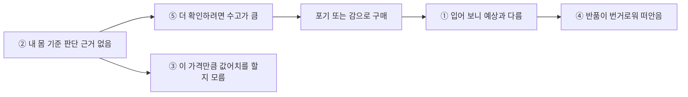

# 페인포인트 · 페르소나 · HMW

> 결론: 가장 강한 페인포인트는 "받아서 입어 보니 예상과 다르다"와 "사기 전에 내 몸에서 어떨지 판단할 근거가 없다"다. 팀은 "사기 전에 무엇을 확인하려 하는가"를 기준으로 핏 확인형과 실물 확인형 두 페르소나에 합의했고, 핏 확인형을 주 페르소나로 삼았다.

## 1. 공통 페인포인트

설문과 인터뷰 **양쪽 모두에서** 나타난 것만 페인포인트로 인정했다. 이 분석은 구글 폼 원자료 22명 기준이다(팀 공식 24명 중 원자료로 확인된 인원).

| # | 페인포인트 | 여정 단계 | 설문 근거 | 인터뷰 근거 | 강도 |
|---|---|---|---|---|---|
| ① | 받아서 입어 보니 예상과 다르다 (핏·어울림·사이즈·색상) | 받은 뒤 | 실패 경험 16/22, 그중 핏·사이즈·색상 이유 14/16, 주관식 6/11 | 3/5 (A, B, D) | 강 |
| ② | 사기 전에 '내 몸에서 어떨지' 판단할 근거가 없다 | 사기 전 확인 | 가장 불편한 점 13/22, 체형 비슷한 후기 없음 14/22 | 2/5 (A, B). C는 맞춤 체형 설정으로 대응 | 강 |
| ③ | 이 가격만큼 값어치를 할지 모르겠다 | 결정 | 가격 때문에 안 삼 9/22 (그중 8명이 사이즈·품질 불편), 주관식 4/11 | 3/5 (B, D, E) | 중 |
| ④ | 실패해도 반품이 번거로워 그냥 떠안는다 | 실패 후 처리 | 반품·교환·안 입은 옷 16/22 (구분 불가), 주관식 2 | 반품 안 함 4/4, '귀찮아서' 3/4 | 중 |
| ⑤ | 더 확인하려면 수고가 커서 포기하거나 감으로 산다 | 사기 전 확인 | 다른 곳까지 찾아보는 사람 12/22, 후기 자체가 적음 7/22 | 2/5 (A, B), 앱 밖 탐색 0/5 | 중 |
| ⑥ | 사고 나서야 잘 안 입게 될 옷이라는 걸 안다 | 결정·받은 뒤 | 3건 | 1/5 (C) | 참고 (기준 미달) |

### 페인포인트 사이의 관계 (가설)

뿌리는 ②다. 사기 전에 결과를 알 수 없으니 확인에 수고가 들고, 가격이 부담스러워지고, 실패로 이어진다. 결말은 ④다. 자료로 확인한 인과가 아니라 여정의 순서로 세운 가설이다.

### 여정 단계별로 보면

| 단계 | 찾기 | 사기 전 확인 | 결정 | 받은 뒤 | 실패 후 처리 |
|---|---|---|---|---|---|
| 페인포인트 | 거의 없음 | ② ⑤ | ③ ⑥ | ① | ④ |
| 근거 | 설문 2/22, 인터뷰 0/5 | 설문 13/22·14/22, 인터뷰 2/5 | 설문 9/22, 인터뷰 3/5 | 설문 16/22, 인터뷰 3/5 | 인터뷰 반품 안 함 4/4 |

## 2. 팀 합의 페르소나

팀원 5명이 각자 설문·인터뷰 원자료로 페르소나·저니맵·HMW를 만들었다. 유형을 나눈 기준은 저마다 달랐지만, 모두 "키·몸무게만으로는 내 몸에서의 결과를 알 수 없다"를 중심 문제로 짚었다. 이 공통점에서 출발해 아래 두 유형에 합의했다. 페르소나의 이름·나이·직업은 가상이다.

### 유형 1. 핏 확인형 · 서윤 (주 페르소나)

> "다 확인했는데 왜 안 맞지?"

사기 전에 "이 옷이 내 몸에 맞나"(사이즈, 비율, 체형)를 확인하려는 사람. 설문에서 후기의 작성자 키·몸무게를 가장 먼저 보거나 앱 필터를 쓰는 13/24.

| 항목 | 내용 |
|---|---|
| 확인 방법 | 키로 거르고 몸무게로 다시 거른 뒤 사진, 자세한 글, 실측표 순으로 봄 (앱 필터 사용 8/13) |
| 막히는 순간 | ① 필터를 걸면 남는 후기가 적음 ("비슷한 체형 후기가 없었다" 8/13) ② 숫자가 같아도 결과가 다름. "후기 사람과 신체 비율이 달랐다"(B) ③ 체형을 타는 옷인지 놓침. 프리사이즈 쫄티를 받아 보니 "몸 부각이 심했어요"(A) |
| 결말 | 최근 6개월 3벌 이상 실패 6/13. 실패한 옷은 반품하지 않고 두거나 중고로 팜 |
| 참여 의향 | 정보 입력 12/13, 조건 없이 후기 작성 5/13 |
| 변형 | 남성은 비슷한 후기를 찾기 더 어렵고(찾기 쉬운 정도 남 2.5점, 여 3.3점) 사이즈·어깨 핏에서 실패함 |
| 인터뷰 근거 | A, B, C |

**저니맵 (감정 −2 ~ +2, 발언을 읽고 매긴 상대적 표시)**

| 단계 | 감정 | 행동 | 문제 지점 | 기회 영역 |
|---|---|---|---|---|
| 1. 발견 | +1 | 앱에서 필요한 스타일 검색 | — | — |
| 2. 후보 담기 | 0 | 장바구니에 담아 두고 고민 | — | — |
| 3. 사기 전 확인 | −1 | 키·몸무게 필터 → 사진 → 글 → 실측 | 키·몸무게가 같아도 비율·체형은 거를 수 없다 | 비율·체형까지 비슷한 결과 |
| 4. 결제 | 0 | 비슷한 후기가 있으면 구매, 없으면 포기하거나 감으로 | 근거 없이 결정한다 | 비슷한 후기가 없을 때의 판단 근거 |
| 5. 받고 입어 봄 | −2 | 실측을 보고 샀는데도 밑위·기장이 안 맞거나 체형이 드러남 | 할 수 있는 확인을 다 해서 실패가 더 크게 느껴진다 | 안 맞은 부위와 내 체형 정보 남기기 |
| 6. 실패 후 처리 | −1 | 반품 없이 보관하거나 중고 판매 | 실패 원인이 어디에도 남지 않는다 | 실패 정보가 다음 판단에 쓰이기 |
| 7. 다음 구매 | −1 | 후기 사진으로 체형을 더 꼼꼼히 봄 | 기준이 개인의 학습으로만 남는다 | 지난 실패를 기억해 주기 |

### 유형 2. 실물 확인형 · 도현

> "사진이랑 똑같을까, 이 돈 값을 할까?"

사기 전에 "이 옷 자체가 사진과 같고 값을 하나"(색감, 옷감, 퀄리티)를 확인하려는 사람.

| 항목 | 내용 |
|---|---|
| 확인 방법 | 키·몸무게 대신 착용 사진의 느낌을 봄 (후기에서 착용 사진부터 보는 사람 10/24) |
| 막히는 순간 | ① 색감과 옷감이 사진과 다름 (색상·소재로 실패 4/24, 4명 모두 꽤 확신하고 샀음) ② 품질과 관리 난이도를 알 수 없음 (가격 관련 이유로 안 샀거나 가격 대비 품질을 모르겠다 12/24) |
| 대응 | 싼 옷은 사고 실패를 감수함. 비싼 옷은 미루거나 매장에서 삼. "눈으로 확인했을때 옷의 컨디션을 바로 알 수 있어서"(B) |
| 참여 의향 | 착샷만 보고 빨리 사는 응답자 5명 중 정보 입력 거부 3명, 후기 안 올림 4명 |
| 인터뷰 근거 | D, B(가방), A(흰 바지), C 일부 |

### 공통

| 구분 | 문제 | 근거 |
|---|---|---|
| 실패 이후 | 실패한 옷을 반품하지 않고 떠안음 | 인터뷰 실패 경험자 4/4 |
| 후기 공급 | 적립금이 없으면 후기를 안 씀 | 인터뷰 4/5, 설문 조건 없이 후기 작성 5/24 |

## 3. HMW

| 구분 | HMW |
|---|---|
| 핏 확인형 · 대표 | 키·몸무게가 같아도 달라지는 비율·부위 차이(밑위, 기장, 어깨)를 사기 전에 알아차리게 하려면? |
| 핏 확인형 · 보조 1 | 이 옷이 어떤 체형에 유리한 옷인지, 내 몸의 어디를 드러내거나 가릴지 사기 전에 가늠하게 하려면? |
| 핏 확인형 · 보조 2 | 비슷한 체형의 후기가 적거나 없는 상품에서도, 나와 비슷한 사람이 입었을 때의 정보를 얻게 하려면? |
| 실물 확인형 · 대표 | 매장에서 직접 보고 입어 볼 때 얻는 확신(색감, 옷감, 퀄리티)을 온라인에서 대신하려면? |
| 실물 확인형 · 보조 | 내가 고른 바로 그 옵션의 실제 색감과 옷감을 사기 전에 가늠하게 하려면? |
| 공통 1 | 적립금이 아니어도, 체형 정보와 착용 사진이 담긴 후기를 남기고 싶어지게 하려면? |
| 공통 2 (가설) | 방치되는 실패 경험이 다음 구매 판단에 쓰이게 하려면? |
| 다각화 | 후기에서 얻고자 하는 경험을 어떻게 후기 없이 전달할 수 있을까? |

DANGJANG은 핏 확인형 대표 HMW와 보조 2, 그리고 다각화 HMW(후기 없이 정보를 주기)에 답한다. 비교 기준을 남의 후기가 아니라 이미 잘 맞는 내 옷으로 바꿨기 때문이다.

## 4. 아직 모르는 것

| 우선 | 아직 모르는 것 | 확인 방법 |
|---|---|---|
| 높음 | 내 옷을 등록하는 수고를 감수할지. 설문은 키·몸무게·스타일 입력 의향만 물었다 | 프로토타입 유저 테스트에서 첫 옷 등록 완료율 |
| 높음 | 키·몸무게가 비슷할 때 결과를 가르는 부위가 무엇인지 | 실패 사례 수집: 어디가 안 맞았나요? (기장·밑위·어깨·허리 등) |
| 중간 | 반품하지 않는 실제 비율과 이유. 지금은 인터뷰 4명이 근거다 | 실패 후 처리를 나눈 설문 문항 |
| 낮음 | 실물 확인형이 실패를 비용으로 느끼는지 | 추가 인터뷰 3~5명 |
