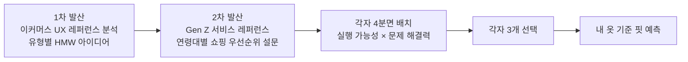

# 솔루션 도출

> 결론: 유형별로 아이디어를 발산한 뒤, 기간 내 실행 가능성과 문제 해결력이 둘 다 높은 영역에서 팀원이 각자 3개씩 골랐다. 그 결과가 "내 옷 기준 핏 예측"이고, 10월 16일 중간발표에서 공유했다.

## 1. 진행 과정

| 단계 | 기간 | 내용 |
|---|---|---|
| 1차 발산 | ~10/7 | 이커머스 서비스의 UX를 최대한 많이 찾아 분석하고, 유형별 HMW를 풀 아이디어를 제약 없이 발산 |
| 2차 발산 | ~10/12 | 이커머스 밖에서 최근 Gen Z 사이에 유행한 서비스의 UX를 분석. 연령대별 패션 쇼핑 우선순위 설문을 심리테스트 형식으로 배포 |
| 선정 | 10/12 | 각자 아이디어를 실행 가능성 × 문제 해결력 4분면에 배치하고, 둘 다 높은 영역에서 3개씩 선택해 토론 |
| 공유 | 10/16 | 중간발표에서 방향 공유 |

멘토 1회차 피드백도 같은 방향이었다. 글로벌 이커머스 사례를 탐색하고, 여러 UX 시나리오를 만든 뒤 평가 기준을 적용해 상위 3개 안으로 좁히라는 것이었다. 이후 공통 기능(옷 등록, 사이즈 추천 규칙) 위에 화면 흐름이 다른 세 안을 기능명세서로 정리했다.

| | 1안 · 상품 단위 핏 검증 | 2안 · 옷장 기반 탐색 | 3안 · 비주얼 옷장 코디 |
|---|---|---|---|
| 핵심 질문 | "이 상품, 나한테 맞을까?" | "청바지 중에 나한테 맞는 게 뭐지?" | "이걸 사면 내 옷이랑 어떻게 입지?" |
| 출발점 | 상품 하나 | 찾는 아이템 또는 내 옷 | 내 옷장 |

지금 데모는 1안처럼 상품 상세의 비교가 중심이고, 홈의 옷장 기준 추천은 2안에 가깝다. 3안의 코디는 로드맵으로 미뤘다.

## 2. 첫 와이어프레임 메모 (팀 노션)

| 영역 | 처음 생각한 것 |
|---|---|
| 기준 옷 등록 | 자사몰 구매는 구매내역에서 불러오기. 타사몰 구매는 URL 입력 또는 실측 캡처 업로드. 기록이 없으면 가이드에 맞춰 사진 촬영(선택)이나 실측 직접 입력 |
| 등록 디테일 | 잘 맞음/안 맞음으로 먼저 고르고, 상의는 총기장·어깨·가슴·소매·밑단 기준으로 안 맞은 부분을 간단히 받기. "등록할 때의 허들이 높으면 절대 안 됨. 우리의 타겟은 적립금을 줘도 후기 입력도 안 함" |
| 비교 방식 | 카테고리에 맞춰 기준 옷과 상품 실측을 비교해 사이즈를 추천. 도식 위에 겹쳐서 어느 부분이 맞고, 부족하고, 넘치는지 아주 단순한 UI로 |
| 코디 | 사려는 상품을 내 옷장의 옷과 간단히 배치해 보기 |

## 3. 이후 바뀐 결정

| 처음 | 지금 | 이유 | 근거 |
|---|---|---|---|
| 잘 맞음/안 맞음을 고르고 안 맞은 부위를 받음 | 잘 맞는 옷만 등록. 등록할 때 핏을 묻지 않음 | 안 맞는 기준이 사람마다 달라 분류가 복잡하고, 추천 로직까지 다시 설계해야 함. 등록 허들을 낮춤 | 멘토링 4회차 |
| 구매하면 옷장에 담음 | 배송 완료 → 구매 확정 뒤 "옷장에 담을까요?" | 반품한 옷은 안 맞는 옷으로 봄 | 멘토링 4회차 |
| 사진 촬영으로 치수 인식 | 사진 측정과 함께 직접 입력도 둠. 잘못된 입력을 알려 주는 규칙은 아직 정리 중 (`reviews/2026-10-26-출시수준-점검목록.md` A1) | 3cm만 달라도 다른 옷이라 정밀도가 중요함. 사용자가 잘못 입력했을 때 알려 주는 방법이 필요함 | 멘토링 3회차 |
| 상의·하의·아우터 | 재는 부위가 같은 옷끼리 묶은 그룹 8개(긴팔·반팔 상의, 짧은·긴 아우터, 긴바지·반바지, 긴치마·짧은 치마) | 멘토가 카테고리가 늘어날 때의 확장성을 고려하라고 함. 비교는 재는 부위가 같은 옷끼리만 의미가 있음 | 멘토링 3회차, 팀 결정 |
| 코디 배치 | 로드맵으로 미룸 | 지금 기능의 유저 검증을 먼저 함 | 멘토링 4회차 |
