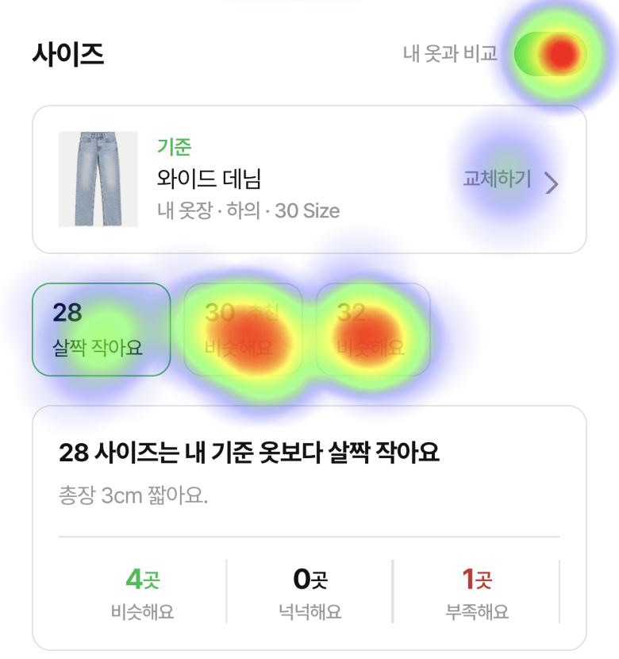
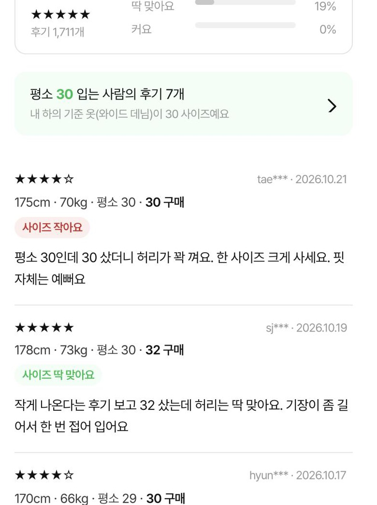
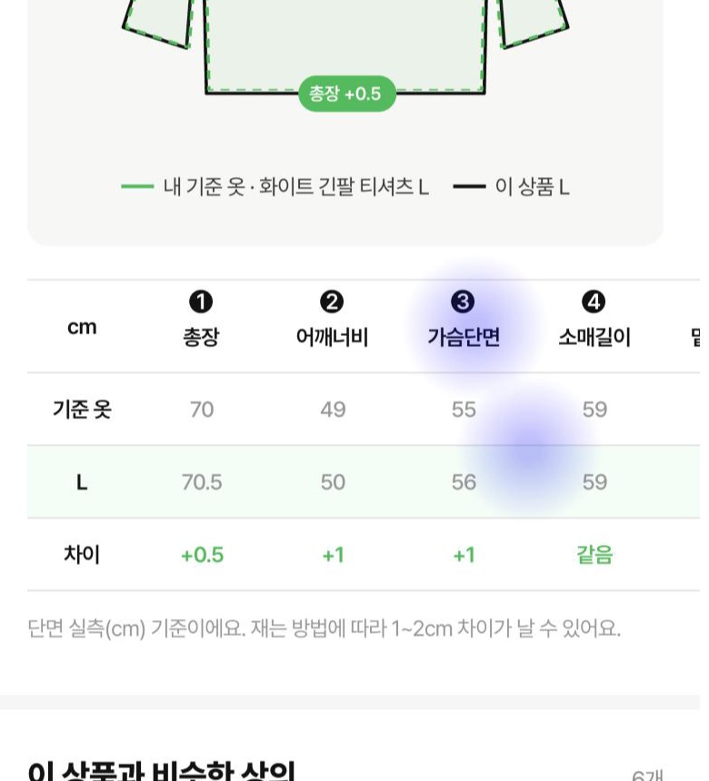
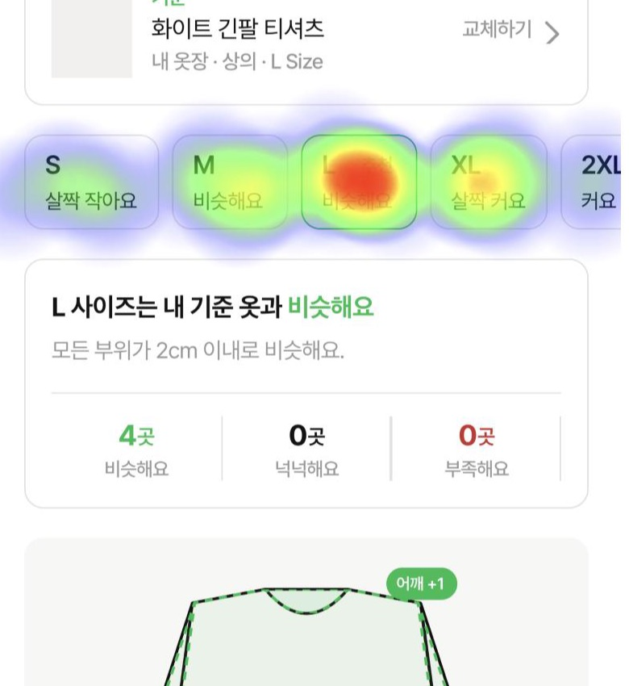
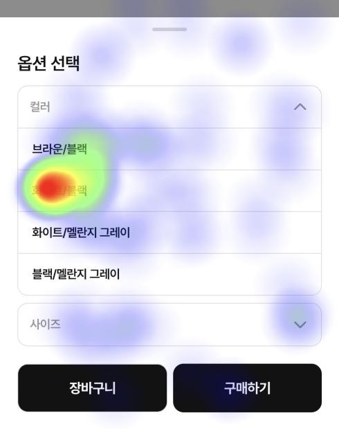

# 07. 유저테스트: 사이즈 셀렉터

옷장 비교가 실제로 사이즈 선택을 바꾸는지 Maze로 확인했다. 설문 응답과 화면별 히트맵(어디를 몇 번, 몇 명이 눌렀는지)을 함께 봤다.

| 항목 | 내용 |
|---|---|
| 도구 | Maze ("DangJang Size Selector") |
| 진행 | 2026-10-23 |
| 참가 | 19명. 과제별로 11~18명이 끝까지 답했다 |
| 설정 | 참가자가 '하늘'(178cm·76kg, 평소 상의 XL·바지 30)의 옷을 대신 고른다 |

## 한 줄 결론

옷장 비교는 사람들이 '평소 사이즈' 습관을 버리게 만들었다. 다만 비교 그림은 결정에 거의 쓰이지 않았고, 두 사이즈가 다 '비슷해요'로 나오면 사람들은 후기를 따라갔다.

- 같은 티셔츠에서 맞는 사이즈(L)를 고른 사람: 무신사 17명 중 7명 → DANGJANG 14명 중 10명
- 후기가 거의 없는 신상에서도 12명 중 11명이 추천 사이즈를 골랐다
- 데님에서는 11명 중 7명이 추천(30)을 두고 32를 골랐다. 원인은 화면 문구에 있었다 (발견 1)

## 핵심 가설: 같은 티셔츠, 무신사와 DANGJANG

과제 1(무신사 실제 상품)과 과제 2(DANGJANG 프로토타입)는 사이즈별 실측이 같은 상품이다. 하늘이 가장 잘 맞는다고 등록한 기준 옷이 L이라서, 맞는 사이즈는 L이다.

| 지표 | 무신사 | DANGJANG |
|---|---|---|
| L을 고른 사람 | 17명 중 7명 (41%) | 14명 중 10명 (71%) |
| 맞을 거라는 확신 (7점 만점) | 4.7 | 5.2 |
| 고르기 쉬웠던 정도 (7점 만점) | 4.9 | 5.4 |

결정에 가장 큰 영향을 준 것:

| 무신사 (16명) | | DANGJANG (13명) | |
|---|---|---|---|
| 평소 사이즈 | 7명 | 서비스 추천 | 6명 |
| 글 후기 | 4명 | 글 후기 | 3명 |
| 사이즈표 | 2명 | 사이즈표, 사진 후기, 사이즈 평가 요약, 평소 사이즈 | 각 1명 |
| 사진 후기 | 2명 | 옷 겹쳐 본 그림 | 0명 |
| 사이즈 평가 요약 | 1명 | | |

비교 그림의 초록 점선이 '등록한 기준 옷'이라고 맞힌 사람은 54%였다.

## 과제별 결과

| 과제 | 고른 사이즈 | 확신 | 성공률 | 평균 시간 | 미스클릭 |
|---|---|---|---|---|---|
| 1. 무신사 티셔츠 (실제 사이트, 17명) | XL 8명, **L 7명**, M 2명 | 4.7 | – | – | – |
| 2. 같은 티셔츠, DANGJANG (추천 L, 14명) | **L 10명**, XL 4명 | 5.2 | 92.9% | 99.3초 | 70.7% |
| 3. 후기 없는 신상 (추천 M, 후기 2개, 12명) | **M 11명**, L 1명 | 5.1 | 100% | 36.5초 | 53.3% |
| 4. 데님 (추천 30, 11명) | 32 7명, **30 4명** | 5.3 | 100% | 41.5초 | 64% |

굵은 글씨가 추천 사이즈다. 과제 1은 추천이 없는 무신사라서 맞는 사이즈(L)를 굵게 표시했다. 미스클릭률은 프로토타입에 연결하지 않은 버튼을 누른 것까지 모두 포함한 값이라 실제보다 높다 (발견 4).

## 히트맵에서 찾은 것

Maze 화면별 히트맵과 요소별 클릭 수(몇 번 눌렸고 몇 명이 눌렀는지)를 기준으로 정리했다. 캡처에서 빨간색일수록 클릭이 많은 곳이다.

### 1. 데님에서 추천이 무시된 이유는 '비슷해요'가 두 개였기 때문이다 (고쳐야 함)

데님 상세 화면의 사이즈 비교에서 30(추천)과 32가 둘 다 '비슷해요'로 나왔다. 같은 화면 아래 후기 요약은 "작아요 81%"였고, 첫 후기는 "평소 30인데 30 샀더니 허리가 꽉 껴요. 한 사이즈 크게 사세요"였다. 화면이 둘 중 하나를 골라 주지 않으니 사람들은 후기를 따라갔다.

| 데님 상세 · 사이즈 영역 | 같은 화면 아래 · 후기 요약 |
|---|---|
|  |  |
| 30과 32 칩을 번갈아 누른 흔적이 가장 진하다. '내 옷과 비교' 토글도 많이 눌렸다. | 클릭은 거의 없지만, 사이즈 칩 바로 아래에서 "작아요 81%"와 "한 사이즈 크게 사세요"가 보인다. |

- 30 사이즈 칩: 28회, 10명
- 32 사이즈 칩: 21회, 9명
- 옵션 시트에서 32로 구매: 12명 중 7명
- 후기 목록 전체를 연 사람: 12명 중 2명

과제 2 티셔츠도 M과 L이 둘 다 '비슷해요'였다. 그런데 그때는 후기가 추천과 부딪히지 않아서 14명 중 10명이 추천(L)을 골랐다. 차이를 만든 건 '비슷해요가 두 개'인 상태에서 후기가 반대 신호를 준 것이다. 30과 32의 실측 차이는 히트맵 화면에서 확인하지 못해서 프로토타입 원본에서 봐야 한다.

**할 일:** 두 사이즈가 다 '비슷해요'일 때 하나를 골라 주는 문구를 넣는다. 후기와 비교 결과가 부딪힐 때 설명하는 방식을 정한다. 예: "후기는 작다고 하지만, 내 기준 옷과 비교하면 30이 맞아요."

### 2. 비교 그림은 '안 본' 게 아니라 '눌러도 반응이 없었던' 것이다 (기회)

설문에서는 그림이 결정에 영향을 줬다는 사람이 없었다. 그런데 히트맵에서는 세 과제 모두 사이즈 비교 영역에 연결되지 않은 클릭이 몰렸다. 옷 그림 몸통과 표의 부위 이름(어깨, 가슴 등)을 눌러 본 흔적이다.

- 과제 2 티셔츠 비교 영역: 19회, 7명
- 과제 3 신상 비교 영역: 21회, 8명
- 과제 4 데님 비교 영역: 22회, 4명

티셔츠 상세의 비교 그림과 실측 표. 그림 몸통, 표의 '가슴단면' 열과 L 행을 누른 흔적이 있다. 모두 연결되지 않은 곳이다.

**할 일:** 부위를 누르면 그 부위의 차이를 강조하는 인터랙션을 검토한다. 점선이 헷갈린다는 의견도 있었으니 기준 옷과 상품을 구분하는 표현도 같이 바꾼다.

### 3. 사이즈를 바꿔 가며 비교하는 동작은 활발했다 (잘 되는 것)

과제 2에서 추천 L 말고 다른 사이즈 칩도 많이 눌렀다. 추천을 그대로 믿기보다 사이즈별 비교를 직접 확인한 것이다. 이 탐색을 더 빠르게 만들면 효과가 클 것이다.

- XL 칩: 6명 (9회)
- M 칩: 3명 (8회)
- S 칩: 3명 (4회)
- 2XL 칩: 2명 (2회)

티셔츠 상세의 사이즈 칩. 추천 L이 가장 진하지만 S, M, XL까지 고르게 눌렸다.

과제 3은 옵션 시트마다 평균 1.4~1.8초가 걸렸고, 거의 모두 막힘없이 구매까지 갔다.

### 4. 미스클릭률 70%는 상당 부분 프로토타입 탓이다 (해석 주의)

과제 2의 옵션 시트는 정해진 한 곳을 눌러야 다음 화면으로 넘어가게 연결돼 있었다. 다른 색상, 사이즈 칸, 어두운 배경을 누른 클릭이 모두 미스클릭으로 잡혔다. 다른 화면에서는 한 사람이 같은 아이콘을 25번 누르기도 했다. 실제 UX 문제로 볼 수 있는 건 발견 2의 비교 영역 클릭 정도다.

- 옵션 시트 미스클릭률: 80.2%
- 한 아이콘 반복 클릭: 25회, 1명

옵션 시트. 진한 점 하나를 빼면 옅은 클릭이 시트 전체에 흩어져 있다. 대부분 연결되지 않은 선택지를 누른 것이다.

**할 일:** 보고할 때 미스클릭률을 그대로 인용하지 않는다. 다음 테스트에서는 옵션 시트의 다른 선택지도 연결해 둔다.

## 참가자 목소리

| 주제 | 응답 |
|---|---|
| 핏 취향 | "1~2 정도 크게 입는 걸 선호하거든요… 마지막 바지에서는 일부러 약간 큰 걸 골랐어요." |
| 소재와 실측 정확도 | "딱 달라붙는 소재라면 '치수상으로는 맞지만 더 작게 느껴질 수 있다' 같은 설명이 있으면 좋겠어요." |
| 비교 그림 표현 | "내가 등록한 옷이 사려는 옷보다 크면 헷갈리네요… 점선이라서 그럴까요?" |
| 후기는 여전히 필요 | "수치 비교가 도움이 되긴 하는데, 다른 사람들의 후기가 같이 있어야 확신이 드는 것 같습니다." |
| 추천을 믿게 된 경험 | "평소에 XL을 입는데 L을 추천하니 불안할 것 같긴 해요. 반품·교환이 원활하다면 추천대로 살 것 같아요." |
| 온보딩 | "어떤 옷을 기준으로 삼느냐에 따라 많이 달라질 것 같아요. 온보딩에서 잘 설명해 주시면 좋겠어요." |

| 비교용으로 등록할 옷 개수 (11명) | | 사이즈 걱정이 줄 것 같다 (11명, 평균 5.1 / 7) | |
|---|---|---|---|
| 2~3벌 | 9명 | 7점 | 4명 |
| 1벌 | 2명 | 4~5점 | 5명 |
| 4벌 이상 · 안 함 | 0명 | 2~3점 | 2명 |

사이즈 걱정 응답은 양쪽으로 갈렸다. 2~3점을 준 사람들이 다음 인터뷰 대상이다.

## 다음 할 일

| 순서 | 할 일 | 근거 |
|---|---|---|
| 먼저 | 두 사이즈가 다 '비슷해요'일 때 하나를 골라 주기 | 데님에서 11명 중 7명이 추천을 벗어남. 칩 문구와 후기 요약이 부딪힌 게 원인 |
| 먼저 | 비교 결과와 후기가 다를 때 설명하는 문구 정하기 | "후기는 작다고 하지만…" 형태. 후기를 결정 근거로 쓴 사람이 무신사 16명 중 4명, DANGJANG 13명 중 3명 |
| 다음 | 비교 그림을 누를 수 있게 하거나, 숫자 중심으로 정리하기 | 그림이 결정에 영향을 줬다는 사람은 0명인데 비교 영역 클릭은 과제마다 19~22회 |
| 다음 | 핏 취향(딱 맞게 / 여유 있게) 설정 검토 | 오버핏을 좋아해서 일부러 큰 사이즈를 골랐다는 응답 |
| 온보딩 | 기준 옷 등록 목표를 2벌로 | 11명 중 9명이 2~3벌 등록할 수 있다고 답함 |
| 다음 테스트 | 이번 수치를 기준선으로 두고 같은 질문으로 다시 재기 | L 선택 14명 중 10명, 확신 5.2, 그림 영향 0명, 점선 이해 54% |

## 읽을 때 주의할 점

- 참가자가 19명에서 마지막 문항은 11명까지 줄어든다. 방향을 보는 데이터다.
- 주관식에 "test"라는 응답이 하나 섞여 있다. 팀 내부 테스트로 보여 빼고 봤다.
- 참가자는 본인이 아니라 하늘의 옷을 골랐고, PC로 진행한 사람도 있었다. 참가자들이 직접 이 점을 언급했다.
- 과제 2는 "같은 상품"이라고 미리 알려 줬다. 이 안내가 선택에 영향을 줬다는 의견이 있었다.
- 퍼센트는 Maze가 계산한 값이고, "몇 명"은 그 퍼센트와 응답 수로 거꾸로 셈한 값이다.

## 출처

Maze 프로젝트 "DangJang Size Selector"의 리포트와 결과 화면(화면별 히트맵, 요소별 클릭 수). 히트맵 캡처는 결과 화면에서 직접 떴다. 2026-11-02 정리. 원본 링크는 팀 내부 자료라 적지 않았다.
